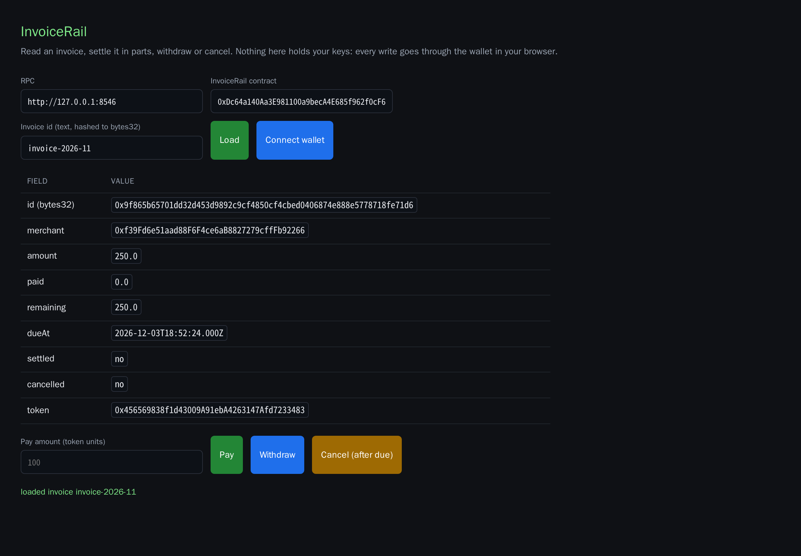

# InvoiceRail — stablecoin invoices on QDay Aevum

A QDay Aevum Builder Challenge entry (deadline 2026-12-11, $1,500 USDT pool).

## What it is

One end-to-end stablecoin payment flow: a merchant issues an invoice in **tUSD8**, a payer settles it in
full or in parts, overpayment is rejected rather than refunded, the merchant withdraws at any time, and
every state change emits an event a bookkeeper can reconcile without indexing raw transfers.

| Step | Function | What it guarantees |
|---|---|---|
| issue | `createInvoice(id, amount, dueAt)` | unique id, future due date, amount > 0 |
| pay | `pay(id, amount)` | partial payments; rejects overpay, past-due, cancelled, settled |
| collect | `withdraw(id)` | merchant only; partial draws allowed |
| expire | `cancel(id)` | merchant only, after the due date; stops payments |
| read | `remaining(id)` | exact amount still due |

Transfers are verified by **balance delta**, so a fee-on-transfer token cannot make the books lie, and
tokens that return no boolean (USDT-style) are supported.

## Layout

```
src/InvoiceRail.sol          the contract (no owner, no upgradeability, no fees)
test/InvoiceRail.t.sol       12 Foundry tests (happy path, partial, overpay, past due, cancel,
                             permissions, no-return token, unknown invoice, zero amount, duplicate id)
script/Deploy.s.sol          deploy against tUSD8, with a no-broadcast simulation mode
```

## Network facts (verified 2026-11-26)

- QDay Aevum testnet, chain id **44005**, RPC `https://rpc-test.qday.info` (eth_chainId = 0xabe5)
- tUSD8 token: `0x456569838f1d43009A91ebA4263147Afd7233483` (1496 bytes of code on chain)
- Faucet: `https://faucet.qday.info/en` — requires the address to hold ETH/USDT/USDC on Ethereum mainnet
  (anti-sybil), which is the current blocker for broadcasting a deployment

## The page




`ui/index.html` is a static page that reads any deployment (RPC + contract address are inputs) and
settles invoices through the browser wallet: load an invoice, pay it in parts with an automatic approval,
withdraw, cancel after the due date. `ethers.umd.min.js` is vendored so the page works offline.

Verified against a local anvil fork of the Aevum testnet: with the contract deployed and one invoice
created, the page rendered `merchant`, `amount`, `remaining`, `dueAt`, `settled`, `cancelled` and the token
address straight from chain state.

## A full flow as a test

```console
$ forge test --match-path test/Lifecycle.t.sol -vv
  1. invoice created: 250 tUSD8 due in 7 days
  2. paid 100 -> remaining 150
  3. paid 150 -> remaining 0
  4. merchant balance 250
  5. expired invoice cancelled
```

## A full flow, simulated against the live testnet

```console
$ forge script script/Demo.s.sol:Demo --fork-url https://rpc-test.qday.info
  1. invoice created for 250 tUSD8, due in 7 days
  2. payer paid 100; remaining: 150
  3. payer paid the last 150; remaining: 0
  4. merchant withdrew: 250
  5. second invoice expired and was cancelled by the merchant
```

The demo runs against the current Aevum state with a local mock token, so the whole path is exercised
without a funded wallet. The same script structure is used for `Deploy.s.sol`, which targets the real
tUSD8 address.

## Commands

```console
forge test                                             # 13 tests
forge script script/Deploy.s.sol --fork-url https://rpc-test.qday.info   # simulate, no broadcast
PRIVATE_KEY=0x... forge script script/Deploy.s.sol --rpc-url https://rpc-test.qday.info --broadcast
```

The simulation runs against the live testnet state and reports the deterministic deployment address,
so the deploy itself is validated before any gas is spent.

## Remaining work

1. Fund the deployer with a small mainnet holding to unlock the faucet, then claim tQDAY and tUSD8
2. Deploy and verify source on `explorer-test.qday.info`
3. Record the demo (issue → two partial payments → withdraw → cancel after due)
4. Submit on DoraHacks with the repo link and the demo video
